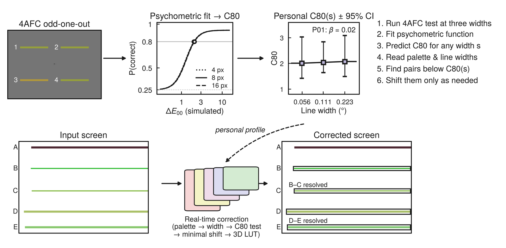
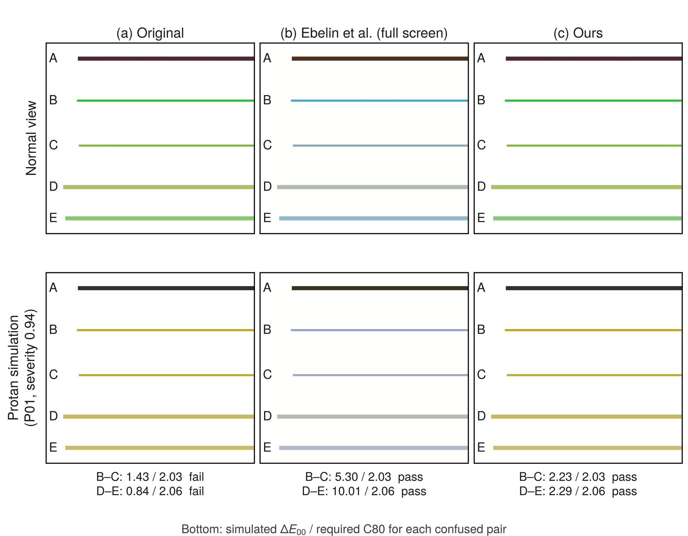
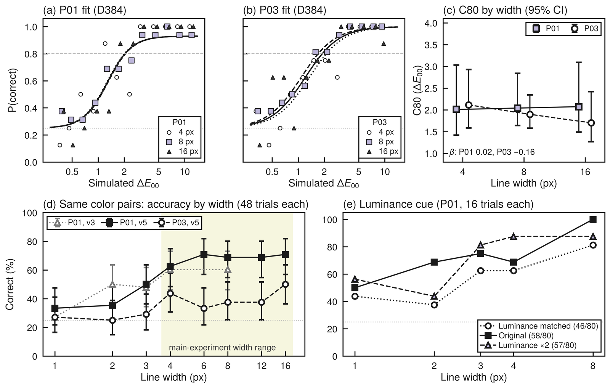
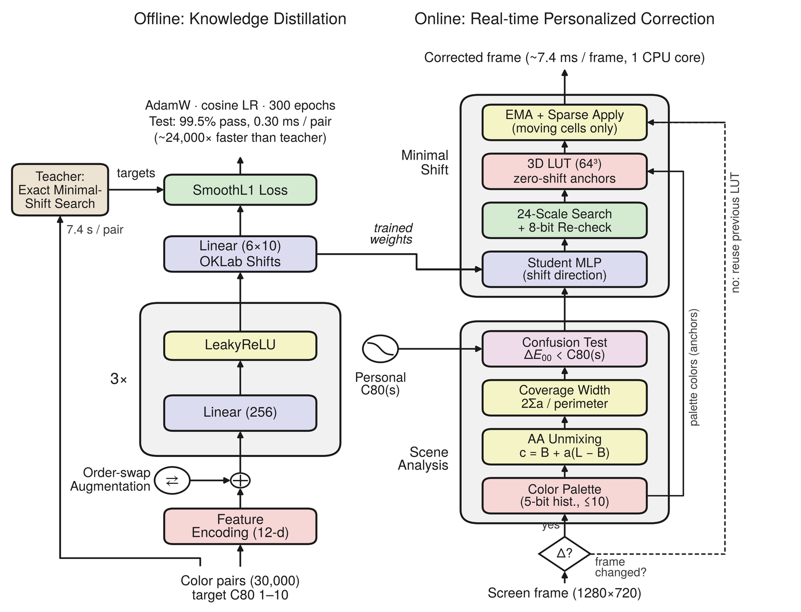
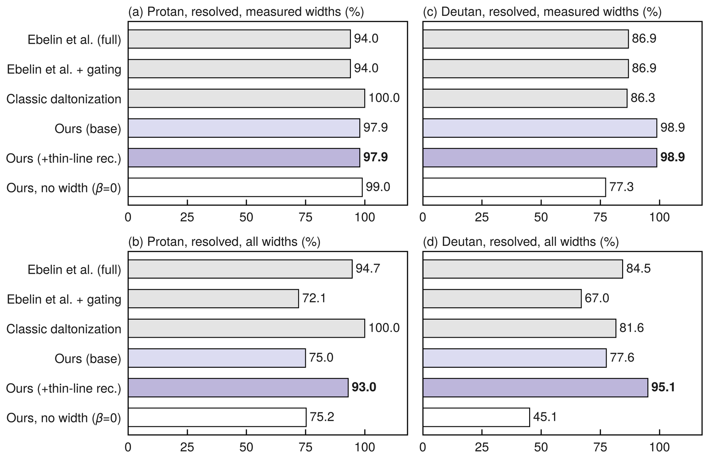
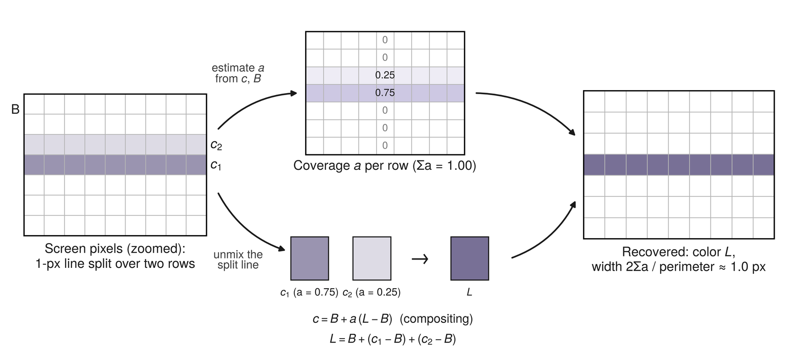
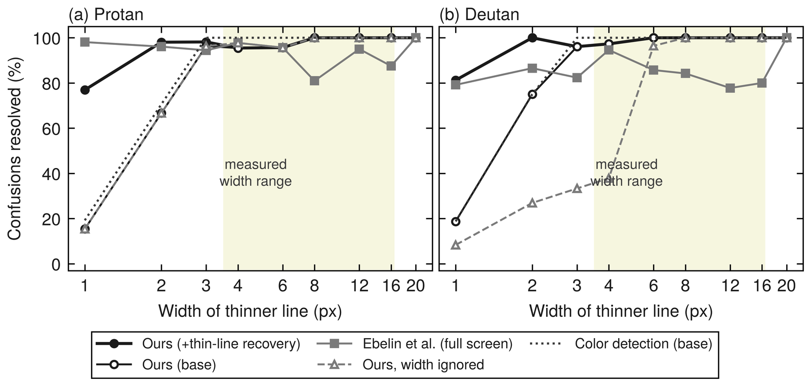

<div align="center">

# PrisChroma

**선 굵기별 색 구별 역치 예측 기반 최소 색이동 보정**

A Study on Thickness-Based Minimal Recoloring for Red-Green CVD

[소개](#소개) · [주요 결과](#주요-결과) · [실험](#실험) · [실행](#실행) · [수치 확인 방법](#수치-확인-방법) · [한계](#한계)



</div>

## 소개

그래프, 지도, 노선도는 색으로 정보를 구분하지만, 적록색각이상자는 일부 색 조합을 구별하기 어렵다. 기존 색 보정은 화면 전체를 한꺼번에 바꾸거나 모든 요소에 같은 색차 기준을 쓰기 때문에, 원래 구별되던 색까지 바뀐다.

같은 두 색도 넓은 면에서는 구별되지만 얇은 선에서는 구별되지 않을 수 있다. PrisChroma는 **선 굵기별로 개인의 색 구별 역치(C80)를 측정**하고, 그 값에 못 미치는 색쌍만 **필요한 만큼만** 옮긴다. C80은 4지선다 과제에서 정답률이 80%가 되는 색차(색각 시뮬레이션 후 ΔE00)이다.

<div align="center">


<sub>위: 정상색각으로 본 화면. 아래: protan 시뮬레이션. 기존 방식(가운데)은 모든 선과 배경을 바꾸고, 본 연구(오른쪽)는 혼동되는 선만 조금 옮긴다</sub>
</div>

## 주요 결과

| 질문 | 결과 |
|:--|:--|
| 선 굵기에 따라 C80이 달라지는가 | 4~16px에서는 확인되지 않았다(두 참가자 모두 굵기 지수 β의 95% 구간이 0을 포함). 같은 색쌍의 정답률은 3px 이하에서 낮아졌다 |
| 혼동을 해결하는가 | 1~20px 선의 혼동 중 93.0%(protan), 95.1%(deutan)를 해결하였다. Ebelin 등의 방식은 94.7%, 84.5% |
| 원본을 보존하는가 | 화면의 1.7% 이하만 바꾸고, 관련 없는 선의 색 변화는 ΔE00 0.00이었다. Ebelin 등의 방식은 모든 픽셀을 바꾸어 14.58~19.22 |
| 실시간으로 동작하는가 | CPU 코어 1개에서 프레임당 6.7~8.2ms. 학생 신경망은 교사 탐색기보다 약 2만 4천 배 빠르다 |

사람 대상 결과는 실험을 끝까지 마친 참가자 2명(P01 protan, P03 deutan)의 사례이다. 시스템 평가는 합성 선 장면에서 계산한 값이며, 사람이 실제로 더 잘 구별하는지는 측정하지 않았다.

## 실험

### 1. 선 굵기별 C80 (본실험)

가로선 4개 중 색이 다른 하나를 고르는 4지선다 과제를 4, 8, 16px에서 참가자당 384회 실시하였다.

| 참가자 | 4px | 8px | 16px | 굵기 지수 β (95% 구간) |
|:--|:-:|:-:|:-:|:-:|
| P01 (protan, severity 0.94) | 2.01 | 2.04 | 2.07 | 0.023 (−0.338 ~ 0.435) |
| P03 (deutan, severity 0.88) | 2.12 | 1.90 | 1.70 | −0.157 (−0.512 ~ 0.204) |

β < 0이면 선이 가늘수록 더 큰 색차가 필요하다는 뜻이다. 두 참가자 모두 구간이 0을 포함하여, 이 굵기 범위에서는 굵기 효과가 확인되지 않았다. 효과가 없다는 것을 입증한 것은 아니다.

<div align="center">


<sub>(a)(b) 심리측정 함수 적합, (c) 굵기별 C80, (d) 같은 색쌍의 굵기별 정답률, (e) 밝기 단서 실험</sub>
</div>

<details>
<summary>코드와 판정 기준</summary>

- 자극 생성과 실험 실행: [`src/stimulus_renderer.py`](src/stimulus_renderer.py), [`src/experiment_runner.py`](src/experiment_runner.py), [`src/response_gui.py`](src/response_gui.py)
- 모형 적합과 신뢰 구간: [`src/psychometrics.py`](src/psychometrics.py), [`src/analyze_calibration.py`](src/analyze_calibration.py)
- 판정 기준: β의 95% 구간 상한이 0보다 작을 때만 굵기 효과를 확인된 것으로 본다. [실험 프로토콜](docs/experiment-protocol.md)
- 두 참가자 모두 실험 전 사전 점검(신뢰 구간 포함률 90%)을 통과하지 못하였다. 위 구간은 실제보다 좁을 수 있다
- P03의 본실험은 절차 편차가 있어 탐색적 결과로만 다룬다

</details>

### 2. 같은 색쌍을 1~16px에서 (v5)

본실험보다 가는 선을 보기 위해, 같은 색쌍을 1, 2, 3, 4, 6, 8, 12, 16px에 제시하였다(참가자당 384회).

| 참가자 | 3px 이하 정답률 | 4px 이상 정답률 | Fisher 정확 검정 |
|:--|:-:|:-:|:-:|
| P01 | 39.6% | 68.3% | p < 0.001 |
| P03 | 27.1% | 40.4% | p = 0.008 |

우연 수준은 25%이다. P01의 본실험과 예비 실험 자료 1,128회를 합쳐 분석하면, C80은 1, 2, 3, 4px에서 5.51, 4.03, 3.31, 2.44로 커지고 6~16px에서는 1.68~2.01로 거의 일정하였다. P03은 3px 이하의 정답률이 우연 수준과 구별되지 않아 같은 형태를 확인할 수 없었다.

<details>
<summary>코드와 주의점</summary>

- 실험 도구: [`tools/common_color_pilot/run_v5.py`](tools/common_color_pilot/run_v5.py), [`wide_pilot.py`](tools/common_color_pilot/wide_pilot.py) ([안내](tools/common_color_pilot/WIDE-PILOT.md))
- 모형 비교(굵기 무관, log 굵기, 4px 이상 포화): [`fit_width_prediction.py`](tools/common_color_pilot/fit_width_prediction.py)
- 이 실험의 색차는 시뮬레이션을 거치지 않은 원본 sRGB ΔE00이다. 본실험의 C80과 수치를 직접 비교하지 않는다

</details>

### 3. 밝기 단서 (v6)

P01에서 두 선의 밝기 차이만 바꾸어 1~8px에서 240회 측정하였다.

| 조건 | 정답 수 |
|:--|:-:|
| 밝기 차이를 0으로 맞춤 | 46 / 80 |
| 원래 색쌍 | 58 / 80 |
| 밝기 차이 2배 | 57 / 80 |

밝기를 맞추면 정답률이 낮아졌다(굵기로 층화한 Cochran-Mantel-Haenszel 검정 p = 0.039). 조건당 시행 수가 적어 굵기별 차이는 구분되지 않았다.

<details>
<summary>코드</summary>

- [`tools/common_color_pilot/lum_pilot.py`](tools/common_color_pilot/lum_pilot.py) ([안내](tools/common_color_pilot/LUMINANCE-PILOT.md))

</details>

### 4. 분석 방법 검증

분석 방법은 모의 자료로 두 번 점검하였다.

| 구분 | 사전 점검 | 가상 참가자 41명 |
|:--|:--|:--|
| 시점 | 각 참가자의 본실험 직전 | 사람 대상 실험 후 |
| 대상 | 그 참가자의 설정을 200회 반복 | 색각 유형, 정도, 굵기 효과의 형태가 서로 다른 41명 |
| 결과 | 신뢰 구간 포함률 85~87%로 기준(90%) 미달 | 색각 유형 37/41 일치, severity 평균 절대 오차 0.08 |

가상 참가자 41명 중 본실험 384회로 굵기 효과가 확인된 경우는 7명이었다. 4px 미만에서만 정답률이 떨어지도록 만든 13명에서는 한 명도 확인되지 않았다. 즉 4, 8, 16px 설계로는 4px 미만에 국한된 효과를 찾기 어렵다.

가상 참가자는 방법 검증에만 사용하였고, 사람 대상 결과에는 포함하지 않았다.

<details>
<summary>코드</summary>

- 사전 점검: [`src/parameter_recovery.py`](src/parameter_recovery.py), [`src/recovery_coverage.py`](src/recovery_coverage.py)

</details>

### 5. 지식 증류

정확하지만 느린 최소 색이동 탐색기를 교사로 삼아, 색쌍 30,000개의 정답으로 작은 신경망(MLP)을 학습시켰다.

| | 교사 (탐색기) | 학생 (MLP + 8-bit 재검사) |
|:--|:-:|:-:|
| 색쌍당 처리 시간 | 7.37초 | 0.30ms |
| 목표 C80 충족 (시험 3,000쌍) | 기준 | 99.5% |
| 색 이동량 (교사 = 1) | 1.00 | 1.13 (중앙값) |

<div align="center">


<sub>왼쪽: 지식 증류. 오른쪽: 실시간 보정 (팔레트 → 혼합색 처리 → 굵기 추정 → 혼동 판정 → 최소 이동 → 3D LUT)</sub>
</div>

<details>
<summary>코드</summary>

- 교사 정답 생성: [`realtime/gen_teacher_labels.py`](realtime/gen_teacher_labels.py)
- 학습과 추론: [`realtime/train_student.py`](realtime/train_student.py), [`realtime/student.py`](realtime/student.py)
- 가중치: [`realtime/models/student_v1/`](realtime/models/student_v1)

</details>

### 6. 기존 실시간 보정과의 비교

합성 선 장면 200개에서 두 참가자의 측정값을 그대로 넣어 평가하였다. 값은 protan(P01) / deutan(P03) 순이다.

| 방식 | 해결률, 4~16px (%) | 해결률, 1~20px (%) | 바뀐 픽셀 (%) | 관련 없는 선의 색 변화 (ΔE00) | 적용 시간 (ms) |
|:--|:-:|:-:|:-:|:-:|:-:|
| Ebelin 등 (기준 모델) | 94.0 / 86.9 | 94.7 / 84.5 | 100 / 100 | 19.22 / 14.58 | 36.3 / 31.1 |
| Ebelin + 범위 제한 | 94.0 / 86.9 | 72.1 / 67.0 | 1.8 / 1.8 | 0.00 / 0.02 | 7.9 / 6.9 |
| 고전 daltonization | 100.0 / 86.3 | 100.0 / 81.6 | 4.0 / 4.1 | 10.33 / 7.84 | 7.9 / 7.1 |
| 본 연구, 굵기 무시 (β = 0) | 99.0 / 77.3 | 75.2 / 45.1 | 1.6 / 1.5 | 0.00 / 0.00 | 8.0 / 7.0 |
| **본 연구** | **97.9 / 98.9** | **93.0 / 95.1** | **1.7 / 1.6** | **0.00 / 0.00** | **8.2 / 6.7** |

두 참가자의 C80이 약 2로 낮아, 화면 전체를 크게 바꾸는 Ebelin 방식도 혼동의 대부분을 해결하였다. 차이는 원본 보존에서 나타났다. 개발에 쓰지 않은 새 장면에서는 1~20px 해결률이 본 연구 84.6 / 86.0%, Ebelin 96.4 / 87.5%로, P01에서는 Ebelin 방식이 더 높았다.

<div align="center">

</div>

<details>
<summary>코드와 주의점</summary>

- 장면 생성과 평가: [`realtime/scene_gen.py`](realtime/scene_gen.py), [`realtime/evaluate.py`](realtime/evaluate.py)
- 기준 모델 변환: [`realtime/base_models.py`](realtime/base_models.py)
- Ebelin 방식은 원래 GPU용이다. 시간 비교는 같은 CPU에서 LUT를 적용한 시간만 해당한다
- 24개 조건(β, 기준 C80, severity)의 민감도 분석에서 본 연구의 1~20px 해결률은 88.9~94.3%, Ebelin 방식은 56.2~99.0%였다

</details>

### 7. 얇은 선 처리

1~2px 선은 안티앨리어싱 때문에 배경과 섞인 색으로만 화면에 나타나서, 처음에는 색 자체를 찾지 못하였다. 합성 방정식으로 원래 색과 굵기를 되돌리는 단계를 넣었다.

| 가는 쪽 선의 굵기 | 처리 전 해결률 | 처리 후 해결률 |
|:--|:-:|:-:|
| 1px | 15 / 19% | 77 / 81% |
| 2px | 67 / 75% | 98 / 100% |
| 1~20px 전체 | 75.0 / 77.6% | 93.0 / 95.1% |

<div align="center">



</div>

<details>
<summary>코드와 주의점</summary>

- 혼합색 처리와 굵기 추정: [`realtime/pipeline.py`](realtime/pipeline.py)
- 굵기별 집계: [`realtime/width_bins.py`](realtime/width_bins.py)
- 반 픽셀씩 걸친 1px 선은 화면 정보만으로는 더 연한 2px 선과 구별되지 않아 되돌리지 못한다

</details>

## 실행

Python과 Tk가 필요하다.

```bash
python -m pip install -r requirements.txt
cd src
python -m unittest -q
```

**1. 두 색의 최소 색이동 보기**

```bash
python two_color_demo.py --help
```

**2. 실시간 보정** (`realtime/`에서 실행)

```bash
python -m pip install -r requirements.txt
python evaluate.py --profile <사용자설정> --display <화면설정> --student models/student_v1/student.npz --scenes 200 --seed0 50000 --aa --out results/evaluation
python realtime_demo.py --profile <사용자설정> --display <화면설정> --student models/student_v1/student.npz --mode student --region 0 0 1280 720
```

설정 파일을 만드는 방법은 [실시간 보정 안내](realtime/README.md)에, 예비 실험 도구의 실행 방법은 [예비 실험 안내](tools/common_color_pilot/README.md)에 있다. 패키지 버전을 고정하려면 `requirements-lock.txt`를 사용한다.

| 경로 | 내용 |
|:--|:--|
| `src/` | 자극 생성, 실험 실행, 역치 분석, 색 보정, 테스트 |
| `realtime/` | 학생 MLP, 혼합색 처리, 3D LUT를 이용한 실시간 보정 |
| `tools/common_color_pilot/` | 1~16px(v5), 밝기 단서(v6) 등 예비 실험 도구 |
| `schemas/`, `data/contracts/` | 설정, 응답, 분석 결과의 데이터 형식과 예제 |
| `docs/` | 실험 프로토콜, 검증 절차, 세션 기록 양식 |
| `assets/` | 이 문서의 그림 |

## 수치 확인 방법

| 확인하려는 것 | 볼 곳 |
|:--|:--|
| 실험 설계와 판정 기준 | [docs/experiment-protocol.md](docs/experiment-protocol.md) |
| 별도 검증 시행의 절차 | [docs/validation-workflow.md](docs/validation-workflow.md) |
| 색각 시뮬레이션과 색차 계산 | [`src/machado.py`](src/machado.py), [`src/distance.py`](src/distance.py), [`src/color_spaces.py`](src/color_spaces.py) |
| 최소 색이동 탐색 | [`src/path_correction.py`](src/path_correction.py), [`src/correction.py`](src/correction.py) |
| 실제로 언제부터 어떻게 작업했나 | [`research-log`](../../tree/research-log) 브랜치 (팀 작업 저장소의 2026-08-20부터의 기록, 참가자 원자료와 개인정보 제외). 나머지 브랜치는 당시의 작업 갈래 |

이 문서의 수치는 연구보고서의 값이다. 이 저장소에는 코드, 공통 설정, 합성 예제만 있고 아래 자료는 없으므로, 저장소만으로 같은 수치가 다시 나오지는 않는다.

- 참가자별 설정과 시행별 응답 원자료
- 학생 신경망의 학습에 쓴 교사 정답 30,000쌍
- Ebelin 등의 참조 변환 파일 (외부 자료)

## 선행 연구

**기준 모델로 비교한 연구**

- Ebelin et al., "Luminance-preserving and temporally stable daltonization," *Eurographics 2023 Short Papers*, 2023. (화면 전체 실시간 보정. 저자들이 공개한 참조 변환을 3D LUT로 옮겨 사용)

**색각 시뮬레이션과 색차**

- Machado et al., "A physiologically-based model for simulation of color vision deficiency," *IEEE Trans. Visualization and Computer Graphics*, 15(6), 2009.
- Sharma et al., "The CIEDE2000 color-difference formula: Implementation notes, supplementary test data, and mathematical observations," *Color Research & Application*, 30(1), 2005.
- Ottosson, "A perceptual color space for image processing," 2020. (OKLab)

**자극 크기와 색 구별**

- Stone et al., "An engineering model for color difference as a function of size," *IS&T Color and Imaging Conference*, 2014.
- Szafir, "Modeling color difference for visualization design," *IEEE Trans. Visualization and Computer Graphics*, 24(1), 2018.
- Mullen, "The contrast sensitivity of human colour vision to red-green and blue-yellow chromatic gratings," *The Journal of Physiology*, 359, 1985.

**측정과 학습 방법**

- Wichmann & Hill, "The psychometric function: I. Fitting, sampling, and goodness of fit," *Perception & Psychophysics*, 63(8), 2001.
- Hinton et al., "Distilling the knowledge in a neural network," arXiv:1503.02531, 2015.
- Porter & Duff, "Compositing digital images," *ACM SIGGRAPH Computer Graphics*, 18(3), 1984.

## 한계

실험을 마친 참가자는 2명이고, 두 명 모두 사전 점검을 통과하지 못하였다. 시스템 평가는 균일한 배경의 합성 선 장면에서 계산한 값이며, 보정한 화면을 사람에게 다시 보여 주는 검증은 하지 않았다. 색도계 없이 명목 sRGB 기준으로 색차를 계산하였다.

---

강원과학고등학교 2026 과학영재 창의연구(R&E) · 이창민, 정인교, 한정훈
